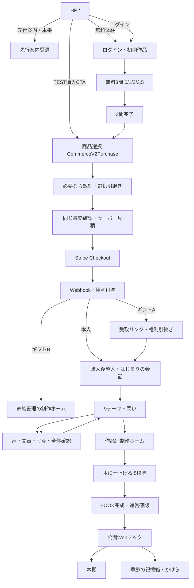
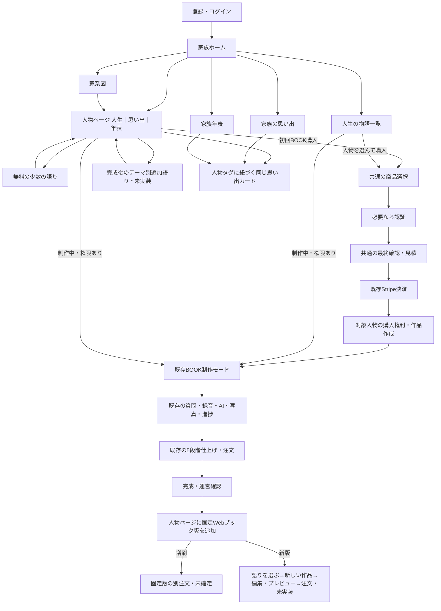

# 家族の場所とBOOK制作モード：現行画面調査・遷移設計案

調査日：2026-11-19。対象：このリポジトリの現行コードと `docs/product/` の仕様正本。**本書は設計資料であり、家族の場所、新版制作、無料枠の実装を示すものではない。** 環境フラグ・本番データごとの到達性は、コードだけで断定しない。

## 0. 結論と構造上の境界

- 現行は「作品を選んで制作する」アプリである。`src/main.jsx` がURL入口を分け、制作の大半は `src/App.jsx` の `scene` 状態で切り替わる。画面ごとの独立URLはほぼない。新しい家族の場所は、**作品を選ぶ前の層**として置き、選んだ作品から既存制作モードへ渡すのが変更範囲を抑える。
- `ensureUserFoundation` はログイン時に本人・家族・初期作品を確保する。現在の無料3問は作品の試用であり、提案中の「人物ごとの少数の無料の語り」や家族登録とは同一ではない。無料家族ホームを成立させるには、初期作品を必須とする前提と購入権限判定を切り離す必要がある。
- 購入画面は `PurchaseSelectionEntry` → `CommerceV2Purchase` を正本とする。HPの公開環境は先行案内登録、TESTは同じ購入画面へ接続するフラグ運用である。35,000円／65,000円は現行商品。新版の5,000円／35,000円は未確定で、現行見積・決済に登録されていない。
- 本棚・公開Webブック・BOOK仕上げ・共通回答UIは再利用できる。家系図、人物プロフィール、家族全体の思い出カード／年表、人物単位の複数版管理は本番機能として確認できない。`FamilyConnectionTest` は隔離TEST用で、`src/lib/familyConnection.js` は既定で本番Supabase接続を拒む。
- 季節の記憶箱は現行の公開後機能。新構想の「季節付与廃止」は**将来仕様と現行仕様の差分**である。既存記録・権限・表示を保護する移行判断が必要であり、画面から無条件に削除しない。

## A. 現行画面・機能一覧

表中の `App:scene` は同じ `/?app=1` 内の画面状態。状態遷移なので、直URLやブラウザの戻るで常にその場面へ復帰できるという意味ではない。表示ボタンは主要導線のみ記載する。共通の認証はSupabase Auth、作品権限は本人・購入／制作管理者・共同管理者・お手伝い等に分かれる。

| 現行画面・役割 | URL／状態・主な遷移 | 主ボタン／条件とデータ | 再利用元・到達性 |
| --- | --- | --- | --- |
| HP・先行案内 | `/` → 登録、無料体験、購入入口、ログイン | 公開HPの購入CTAは `/early-access/`。TEST購入CTAは `/?app=1&entry=purchase`。`LandingPage` と `publicPurchaseCta` | HP自体は現役。一般購入ゲートは閉状態を維持 |
| 初回・ログイン | `/?app=1`、`App:-1` → 本人ホーム／体験／購入続行／招待先 | メールOTP、条件付きLINE、招待トークン。`ensureUserFoundation` が `families`・`persons`・`user_person_links`・`book_projects` を確保 | `Scene_Login`。家族を先に登録する新仕様とは入口の整理が必要 |
| 無料3問 | `App:0 → 1 → 3/3.5 → trial_complete`、再開・期限切れ | 3問の進捗、文章・録音、保存、体験完了から購入。`onboarding_group=trial_experience`、試用作品・回答 | 現役だが新しい無料「人物ごとの語り」とは別枠。`GuestTrialFlow` はフラグ付き別経路 |
| 商品選択・認証・最終確認 | `/?app=1&entry=purchase` → 認証引継ぎ → 同URLのreview | 本人／ギフト、スタンダード／プレミアム、制作方法、追加冊子、割引、サーバー見積。`PurchaseSelectionEntry`／`CommerceV2Purchase` | 共通購入UIを一つだけ再利用。入口の分岐は残るが別の購入画面は増やさない |
| Checkout・購入後 | 上記 → Stripe → `App:purchase_success`／`gift_purchase_success`／`gift_received` | 注文、Webhook、権利・対象作品の接続。ギフトA受取、ギフトB家族管理の分岐 | 購入・権利付与の既存処理。新しい人物選択IDの渡し方は要設計 |
| 制作ホーム | `App:home` → 次の問い、写真から語る、問い一覧、語り、仕上げ、設定／本棚 | `get_book_work`・`book-production-status` により制作中／運営確認中／公開済みを表示。`ApprovedHome` | 再利用。公開済みは季節カードと「ホーム｜記憶のかけら｜本棚」 |
| はじまりの会話・章案内 | `App:onboarding_* / 0 / starting_conversation_complete / theme_guide / hajimari_complete` → 質問／テーマ | 購入後の導入、章の終了と次テーマ案内。質問セット・進捗・onboarding状態 | 現行BOOK固有遷移を保つ。家族ホームからは制作中作品に入った後に表示 |
| 9テーマ・問い | `App:theme_intro / theme_resume / question_library / 1` → 回答入力、前問、次問、`theme_complete` | テーマ選択、問い本文、スキップ、進捗。`storyThemes` と質問DB、`Scene1_MyPage` | 共通回答UIを再利用。進捗・スキップはBOOK固有 |
| 回答入力・確認 | `App:1 → 3 → 3.5 → 1 / 次問` | 声・文章・写真、録音カウントダウン／一時停止、文字起こし／AI整形、写真補正、自動保存・再開、全体確認・正式確定。回答・文章下書き・メディア | `AnswerInputUI`、`Scene_Recording`、`Scene3_5_VoiceCheck`、`BookAnswerPhotoDraft` 等。無料3問は別表示条件あり |
| 写真から語る | `App:photo_story_start` → 質問生成・語り／写真 → BOOK素材 | 写真先行の独立導線。「写真から残した記憶」章に収録。写真・回答・配置設定 | 現役。テーマ別の通常質問とは分類を混ぜない |
| 語りを見る・家族の協力 | `App:story_pages / theme_memory_request / story_request` | 回答一覧、協力の依頼・採用。閲覧／操作は作品ロールで制限 | `Scene_StoryPages` 等を再利用。新しい人物ページの語り一覧へは読み取りアダプターが必要 |
| 家族制作・代理制作 | `App:family_story_* / support_project_home / support_recording_assist / support_story_pages / support_book_builder`。招待URL・`support_project` も入口 | 対象作品の制作・お手伝い、管理者／共同管理者／お手伝いの権限差。`project_supporters`、招待、共有設定 | 既存の制作コンポーネントを呼ぶラッパー。旧 `family_story_*` の現行到達性・整理先は要確認 |
| BOOK仕上げ・プレビュー・注文 | `App:book_builder` または `support_book_builder` → 完成／運営確認 | 表紙→収録→紙面→オプション→注文。`get_book_work`、`save_book_selection`、`book-pdf`、`confirm_book_work`、追加決済 | `Scene_BookBuilder` を共用。最終確定・配送・追加決済は管理権限者に制限 |
| 本棚・公開Webブック | `/?library=1` → `/?voice=<public id>` | 本人／家族の本棚、公開版の章・写真・文章・音声、QR／リンク、場合により暗証番号。`voice_publications` と items | `VoiceLibraryPage`、`Bookshelf`、`PublishedWebBook`。完成確認中は本文を開けない |
| 完成後の季節記録 | 公開後ホーム → `SeasonalMemoryFlow` → 記憶のかけら | 1季節1件、写真・文章・音声、確定、カギ。`seasonal_memory_records` とメディア | **現行機能**。今後の無期限のテーマ別追加語りとは別データ・別権利 |
| 設定・共有／管理 | `App:settings / sharing_privacy / private_story_settings / supporter_management / profile_settings` | 閲覧・制作権限、招待、設定。`story_sharing_preferences`、支持者・家族関係 | 既存権限ロジックは再利用。新しい記録単位の鍵とは粒度が異なる |
| 家族の場所の試作 | `VITE_FAMILY_CONNECTION_TEST=true` 時の `FamilyConnectionTest` | 人物・家族の接続を隔離TESTで確認する画面。`families`／`persons` 等 | **TEST限定**。家系図・家族年表・共有思い出の本番完成機能と見なさない |
| 古い／到達性未確定 | `LegacyScene_Home`、旧購入・一部 `family_story_*`、`GuestTrialFlow` | `LegacyScene_Home` の呼出しは今回の検索で見つからない。旧経路やゲスト体験はフラグ・既存リンク次第 | 削除前にURL流入と注文履歴を確認。新UIの正本にはしない |

権限の概略：本人は自己の作品と許可された家族の公開本を扱う。制作管理者・共同管理者は制作／仕上げ／追加決済が可能、お手伝いは回答等に限られ非公開語り・最終確定・権限変更は不可、という現行正本の区分を引き継ぐ。`src/VoiceLibraryPage.jsx` は認証と `list_voice_library_people`／`list_pending_book_library` で本棚を取得し、公開Webブックは公開IDで別URLにある。新しい「本人だけ」の語りは、一覧件数・詳細・Storageの全経路で既存作品権限より強く絞る必要がある。

## B. 現行の主要画面遷移

補足：`/?library=1` と `/?voice=...` は実URL。無料体験・購入後導入・質問・制作ホーム・仕上げは主に `/?app=1` 内のscene切替である。HP購入CTAは環境で異なる。録音・AI処理、Stripe、PDF生成などの内部APIは画面の独立経路ではない。

## C. 新しい統合遷移案（未実装）

家族の場所をアプリの入口にし、BOOK制作モードには **対象人物ID・対象作品ID・操作権限** を渡す。作品を切り替えても回答／下書き／メディアを作品IDで分離する。購入済み・制作中・完成待ち・公開済みの状態を同じデータから表示し、本人・ギフトA/Bで制作コンポーネントを増やさない。

シナリオ別の最短操作：A `登録 → 家族ホーム → 人物追加 → 家系図 → 思い出追加 → 招待`。B `人物 → 無料の語り → 共通回答入力 → 人生タブ`。C `人物を選択 → 既存の共通購入 → 対象人物に権利付与 → 制作モード → 5段階仕上げ → 人物ページのWebブック`。D `家族ホーム／人生の物語 → 制作中作品 → 同じ制作ホーム`。E `人物 → 固定版を選択 → その版の増刷注文`。F `人物 → 新版作成 → 対象に含める語りを確定 → 既存仕上げ・プレビュー → 別注文 → Ver.2.0`。G `家族の操作アカウント → 主役人物 → 作品ロールを検査 → 同じ制作ホームと回答UI`。C/E/Fの購入・注文は既存の料金処理を無断転用せず、対象人物／版／支払義務者の契約を明確にしてから接続する。

### URLと復帰の提案

新しい家族画面は人物・作品をURLで識別できるようにする（例：`/family`、`/people/:personId`、`/books/:projectId/work`）。これは**設計用の仮URL**で実装済みではない。制作モード内部のsceneを直ちに全てルーターへ移す必要はない。家族画面から入る時と再読み込み時に、URLのIDを認証・権限検査して既存の作品状態へ復帰できればよい。公開 `/?voice=...`、購入後の引継ぎ、招待URLは互換のため維持し、新URLへ誘導する場合も権利確定後に限る。

## D. 画面の対応表

| 区分 | 対象と対応 | 理由・実装境界 |
| --- | --- | --- |
| そのまま再利用 | `AnswerInputUI`、録音／文字起こし／AI整形、写真補正、質問と進捗、BOOK5段階仕上げ、PDF・公開Webブック、Stripe Checkout、公開本の本棚表示 | 新しい家族側から対象作品・権限を渡す。別の制作アプリを作らない |
| 軽微な変更 | 制作ホーム、商品選択への入口、購入後復帰、公開本の人物ページでの表示、既存の本棚 | 選択人物・作品、状態、戻り先を明示。既存決済コンポーネントを共用 |
| 新規作成 | 家族ホーム、人物プロフィール／人生・思い出・年表、家系図、家族年表、共有思い出カード、人物タグ、無料枠・家族容量メーター、完成後の追加語り、BOOK版一覧・新版制作 | 現行には本番用の一連の画面・記録／版管理・容量権利がない。最初はMVPに分割 |
| 統合・整理 | 作品別ホームと家族の場所、本人／家族／代理制作の入口、同じ人物の複数作品一覧、公開本と質問回答の読み取り一覧 | `family_story_*` 等の入口を増やさず、作品ロールで同じ機能へ接続。履歴URLは維持 |
| 当面非表示・新仕様の入口には使わない | 旧購入画面／旧価格、未到達の `LegacyScene_Home`、TEST限定 `FamilyConnectionTest`、新規の季節付与入口（移行判断後） | 既存注文・季節記録・旧リンクは削除しない。旧機能の利用状況を確認してから表示だけ切り替える |

## E. BOOK制作モードのメニュー案

家族の場所の4ナビ（ホーム｜人生の物語｜家族｜思い出）とは別に、**制作中は対象人物名・作品状態を上部に表示**し、「家族の場所へ戻る」を置く。制作中の下部ナビは常時表示しない。制作メニューは既存 `ApprovedHome` の行を再配置し、同じscene handlerへ接続する。

| 作品状態 | 最初に見せる操作 | 続くメニュー | 出さないもの |
| --- | --- | --- | --- |
| 購入済み・導入前 | はじまりの会話を始める／続ける | 問いの一覧、設定（必要時） | 再購入、公開本リンク |
| 制作中 | 次の問いに答える | 写真から語る、問いの一覧、語りを見る、本に仕上げる、招待／協力、設定 | 同じ作品の購入CTA、未公開Webブック |
| お手伝い中 | 許可された問い／写真の記録 | 許可範囲の語り、制作進捗 | 権限変更、非公開語り、最終確定、追加決済 |
| BOOK完成・運営確認中 | 仕上がりを見る（閲覧専用） | 完成確認状況、家族の場所へ戻る | 回答編集、公開前Webブック、再購入 |
| 公開済み | 人物ページのWebブックを読む | テーマ別の追加語り、版一覧、増刷（入口確定後） | 旧「本に仕上げる」、旧版の回答編集 |

役割で操作を隠すだけでは足りない。読み込み・保存・メディアURL・確定APIでも同じ権限判定を使う。複数作品がある場合は作品IDを常に明示し、「次の問い」を別作品の進捗から計算しない。

## F. 未決事項・判断順

1. **無料体験と無料の語り**：HP無料3問を継続するか、アプリ登録後の人物別無料枠とどう別管理するか。枠の件数、音声／動画1分の厳密な上限、超過・失敗・既存無料3問の扱い。無料枠の正式回答を後のBOOKに含める条件。決まるまで試用を新規家族記録へ移さない。
2. **購入権利の単位**：家族IDでなく人物IDに対してどの版・商品を購入するか、ギフトAの受取人が未登録人物へどう接続するか、ギフトBの購入者がどの人物を指定するか。既存注文・作品の互換を保つ。BOOK購入の家族容量特典は家族で一度だけ付与し、複数購入で加算しない。容量数値と現行利用者への適用は未決定。
3. **本人・代理制作の非公開権限**：本人アカウントがない人物の「自分だけ」を誰が設定・閲覧・解除できるか。代理制作者の暫定私有記録を後から本人へ移す手順。人物タグや家族年表から鍵付き記録の存在・件数・Storage URLを漏らさない設計。BOOKへの収録同意と個別語りの家族公開は別設定か、既存固定原本との関係を要確定。
4. **BOOK完成の境界**：既存の「内容・配送・必要な追加決済後に完成→運営確認→公開」を維持し、家族画面で「完成」と「公開」をどう表すか。無料の語りを冊子に含める時点、運営確認中の表示、公開失敗時の復旧。
5. **新版と増刷**：旧版を固定したまま、新版に含める回答／追加語りの選択、版番号の採番、既存写真配置のコピー、注文・PDF・公開IDの独立、再印刷との明確な区別。新版価格5,000円／35,000円は**仮案**。原価・処理・税込／税抜を確定するまで見積・Checkoutへ追加しない。
6. **家族の思い出の範囲**：無料容量・有料容量、動画／音声の長さとStorage費、家族間招待と共有単位、出来事の日付精度、プロフィール由来イベントとカードの重複抑止、登録者／人物タグの削除権限。
7. **現行季節記録の移行**：新規付与をいつ止めるか、公開後の既存箱・記憶のかけら・カギ・猶予期限をどう保存／表示するか。テーマ別の追加語りへ自動変換するかは未決定。既存データを変更せず読む移行案を先に比較する。

## 顧客体験の完成順序（2026-11-19レビュー反映）

| 段階 | 顧客に提供する体験 | この段階で守る境界 |
| --- | --- | --- |
| 第1段階 | 家族ホーム・人物登録・基本家系図 | 家族の場所を作るだけでBOOK作品を作らない。自分自身の人物情報の自動生成は可。 |
| 第2段階 | 思い出カード・家族招待・基本年表 | 無料で家族の記録を育てられる。タグで一つのカードを複数人物から参照し、非公開情報は漏らさない。 |
| 第3段階 | 人生の語り・鍵機能・無料枠 | 現行のBOOK試用3問とは権利・保存先を分離し、共通回答UIや録音処理を再利用する。 |
| 第4段階 | 既存BOOK制作への接続 | 対象人物に紐づく作品へ購入権利を付与し、既存の制作ホーム・回答・仕上げに入る。 |
| 第5段階 | 完成後の追加語り・新版制作 | 旧版を固定し、追加語りと新版を別記録・別注文で扱う。新版価格は未確定。 |

これは**顧客体験の完成順序**。開発時にはBOOK接続のID・権限契約や既存導線の互換確認を早期に並行して進めてよい。家族ホームだけを先に公開して無料の中核機能を長く欠いた状態を完成と見なさない。

画面モックは、`初回登録後の家族ホーム → 家族を1人登録 → 人物の人生の語り入口 → BOOK案内・商品選択 → 既存制作ホーム → 完成後の人物ページ（版一覧）` の6場面を一つの操作フローで比較する。[操作可能な6画面モック](../../public/previews/family-place-book-journey-20261119.html)を参照。モックの人物・価格・版は疑似表示であり、無料枠、新版決済、家系図の本番実装や公開条件を確定しない。商品選択の表示は構成確認用であり、実装では既存の `CommerceV2Purchase` だけを使用する。

### 主なコード根拠

`src/main.jsx`（入口）、`src/LandingPage.jsx`・`src/lib/publicPurchaseCta.js`（HP）、`src/PurchaseSelectionEntry.jsx`・`src/CommerceV2Purchase.jsx`（購入）、`src/App.jsx`（scene・初期基盤・回答・仕上げ・家族制作）、`src/home/ApprovedHome.jsx`（状態別ホーム）、`src/AnswerInputUI.jsx`（共通回答）、`src/VoiceLibraryPage.jsx`・`src/Bookshelf.jsx`・`src/PublishedWebBook.jsx`（本棚・公開本）、`src/SeasonalMemoryFlow.jsx`、`src/FamilyConnectionTest.jsx`・`src/lib/familyConnection.js`（TEST限定）。既存仕様正本は `docs/product/product-spec.md` と `docs/product/user-flows.md`。本書の新構想は現行仕様正本を黙って置き換えない。
