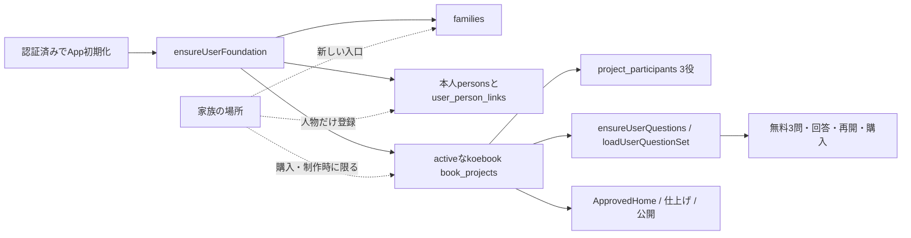

# 家族の場所｜実装前の依存・権限・初回UX調査

2026-11-19。対象は現行コード、migration、既存テストと**本番DBの読み取り専用メタデータ**（列・制約・RLS・Storage bucket設定）。顧客の行データ、本文、ファイルは取得していない。アプリ・DB・本番環境は変更していない。承認済み[Ver1.0画像](design-references/family-power-v1.0-approved-10-screens.png)は引き続きデザインの正本。[6状態レビュー](../../public/previews/family-place-six-states-20261119.html)は維持する。

## 1. 現行の依存関係

`src/App.jsx` の `ensureUserFoundation`（1470行付近）は、家族を検索・作成し、本人のPersonと`self`リンクを検索・作成した後、**同じ呼び出しの中で**本人のactiveな`koebook`作品を探し、なければ質問セット付きBOOK作品を作る。さらにowner/subject/speakerの参加者を確保する。認証済みセッションの初期化と再開時に呼ばれ、直後に`loadUserQuestionSet`が`ensureUserQuestions`を通じて作品の質問を準備する（同2079行付近、3728行付近、7970行付近）。したがって、新しい家族ホームで単純に作品作成部分だけを省くと、後続の`foundation.project.id`参照、質問進捗、購入画面の`projectId`、回答・音声・写真の保存先が壊れる。

例外として、受取・お手伝い作品のみを持つ利用者は`loadUnstartedConnections`で先に作品選択へ進む場合がある（同2605–2665行、3722行付近）。家族接続の入口は`src/main.jsx`の`FamilyTestGate`にあり、`src/lib/familyConnection.js`はTEST以外を既定で拒む。これを無料家族ホームの本番実装としてそのまま開放できない。

本番DBでは`book_projects.family_id`は必須、`subject_person_id`は外部キー、`access_status`の既定値は`trial`。`answers`は`book_project_id`・`subject_person_id`・`user_question_id`を持ち、`media_assets`は`answer_id`必須で作品と人物にも関連する。既存の回答は作品中心の構造であり、人物だけの無料記録として`answers`を無条件に流用しない。

### 既存データを守る最小変更案

1. `ensureUserFoundation`の現行契約は**既存BOOK入口用に残す**。家族の新入口には「家族と本人リンクだけを取得・必要時に作る」小さな処理を分離し、作品IDを要求しない。
2. 既存の購入済み・制作中・ギフト・代理制作作品は現行の作品ID・権利・参加者をそのまま使う。新入口では所有／受取／制作支援の作品を**一覧して選択**し、閲覧可能な作品がないことを理由に自動作成しない。
3. BOOK制作を本人または対象人物に対して明示的に開始する際だけ、既存の購入画面が必要とする作品を作成・再利用する。購入審査・Checkoutの前に、対象人物と作品IDの対応をサーバーで検証する。作品を作ったこと自体は有料権利にならない。
4. 旧入口の質問配布、無料3問、チェックアウト後復帰、ギフトA/B、代理制作は旧契約を維持して回帰を確認する。ログイン直後の新しい家族入口では`loadUserQuestionSet`を呼ばない。

## 2. 公開権限と漏出リスク

| 対象 | 現行の境界 | 家族の場所で必要な変更・確認 |
| --- | --- | --- |
| 家族・人物 | `families`はowner中心。`persons`は所有家族または家族制作の特別な役割で読める。`family_memberships`だけでは全人物の一般閲覧権にならない | 家族招待後に見える人物プロフィールの項目を決め、Person読取API/RLSを家族単位で限定する。人物タグと記録公開を独立させる |
| BOOK作品 | `book_projects`はowner、共同管理者、家族制作の特別な役割で読取。`owner_user_id`、`subject_person_id`、購入者は別列 | 「家族」だから制作できるとは判定せず、対象作品と役割・購入権利を別々に確認する |
| 回答 | `story_sharing_preferences`にprivate/family/selected、各`answers.access_override`にinherit/private_forever。共有先RLSはprivate_foreverを除外 | 家族一覧・件数・検索・通知・サムネイルまで、本人限定の記録を除外。新しい無料記録には独立した本人／家族公開の契約が必要 |
| 代理制作者 | `project_supporters`の操作フラグと`co_manager`等の役割。helperにはprivate回答・メディアの制限が追加済み | **共同管理者は現行RLS/RPCでprivate回答も読める**。新仕様の「本人だけ」と整合するかオーナー判断が必要。本人アカウントのない代理作品のprivateの意味も未決 |
| メディア | `audio`・`photos`・`videos` bucketは非公開。署名URL発行にはStorage RLSが効く。共有先用Storageポリシーはprivate回答を除外 | URLだけでなくメタデータ・Storage path・件数も隠す。音声原本と公開用再生を分け、service-role EdgeもJWTと作品・回答単位で再検証する |

**実装前に直すべき具体的な境界：**本番の`media_assets_shared_recipient_select`は`shared_story_recipient_can_view(book_project_id)`のみを条件とし、対応回答の`private_forever`を見ていない。一方、`answers_shared_recipient_select`と共有先Storageの署名URLポリシーはprivate回答を除外する。本番DBで`authenticated`には`media_assets`のSELECT権限があるため、通常の非家族制作作品の共有受取人が**非公開回答のメディア行・保存パス等を取得できる可能性**がある。これはポリシー構造からの指摘であり、別ユーザーJWTでの実取得は今回未実施。家族一覧を作る前に、回答の公開判定をメディアRLS・RPC・Storageで同じ述語に統一し、本人／家族／代理者それぞれのJWTで拒否を確認する。既存の非公開データを一覧化する前にも、この境界を優先して検証する。

既存の作品共有は「作品全体の共有＋回答ごとの例外」。新しい人物単位の無料記録にそのまま適用することはできない。最小構成では人物に紐づく無料記録をBOOK回答と別の保存先にし、`person_id`・作成者・公開範囲を明示した読取契約を設け、共通入力UIだけ再利用する。新規メディアを扱う場合は専用の紐付け・RLS・Storageパス検査が必要。クライアントの表示フィルターのみで隠さない。

## 3. 購入・制作・完成の接続

| 時点 | 既存資産 | 接続時の条件 |
| --- | --- | --- |
| 公開HP | `src/lib/publicPurchaseCta.js`は本番で先行案内、TESTで購入を表示 | 新家族ホームの無料入口と購入入口を混同しない。一般購入ゲートの状態を維持 |
| 商品選択 | `PurchaseSelectionEntry`→`CommerceV2Purchase`→認証引継ぎ→Checkout。本人購入のレビュー段階では`projectId`を受ける | 対象Personを確定してから作品を取得／作成。既存の作品に購入済み権利があれば再購入を防ぐ |
| 権利付与 | 注文は`commerce_orders.book_project_id`、作品は`book_projects.subject_person_id`と`purchaser_user_id`等を持つ。ギフトは受取後に対象作品へ接続 | 本人購入、ギフトA、ギフトBでowner・主役・購入者・制作管理者が異なる。Person IDだけで制作権限を推定しない |
| 制作再開 | `ensureUserFoundation`は現在、自分のactive作品とローカルの選択作品を読む。支援作品は別経路 | 家族ホームから選んだ**権限ある作品ID**を明示的に渡し、同じ作品へ再開。ローカル保存値は便宜情報に留める |
| 完成・公開 | `confirm_book_work`で回答を選び固定スナップショットを作り、既存の公開・Webブック生成へ接続 | 公開済み作品だけ人物ページの完成BOOKとして表示。原稿確認中／生成失敗を完成扱いしない。作品とPersonの紐付けを検証 |

既存の正常なCheckout・Webhook・公開を作り直さず、**家族画面→対象人物→既存作品／購入→制作ホーム→人物ページ**の境界を検証対象にする。

## 4. 初回UXの机上ウォークスルー

対象：`public/previews/family-place-book-journey-20261119.html` の操作と`public/previews/family-place-six-states-20261119.html`の状態表示。これはコードとモックのウォークスルーであり、初回利用者への観察テストや実保存E2Eではない。

| 最短導線 | 現行モックの状態 | 最小の修正案 |
| --- | --- | --- |
| 新規登録→家族ホーム | 6画面モックに登録・認証画面なし。6状態のAは家族未登録、旧6画面は最初から「あなた」を表示 | 新規登録後の行き先と本人Person自動作成の有無を決め、家族ホームで「最初の一人」を一つの主操作にする |
| 自分／家族を登録 | 旧6画面は名前＋関係の2項目だが、「自分」と「家族」の選択はない | 選択を最初に置く。自分なら既存本人リンクを再利用し、家族なら名前＋関係だけ。後から詳しいプロフィールを追加 |
| 登録→人物ページ | 登録後はホームへ戻り、人物カードをもう一度押す必要がある | 保存成功後はその人物の「人生」タブへ直接進む。ホームへの戻りは常に見える |
| 最初の語りを保存 | 旧6画面の「無料の語りを始める」はアラートのみ。6状態モックも静的で、無料記録の保存先はない | BOOKと分離した人物の無料記録アダプターを設け、保存確認後にその語りを同じ人物ページに1件表示する |
| 人物ページ→家族ホーム | 旧6画面は戻れるが、保存後のホーム反映はない | 戻ったホームでは本人／人物カードに「語り1件」など公開範囲に応じた実数だけ表示。記録の場所を明示する |

現状のモックでは「何を登録するか」は概ね分かるが、**登録後の余分な往復、保存先の不在、保存後に何が増えたか分からない点**が初回価値体験を阻む。無料登録自体は2項目で軽い。本人Personを自動作成する場合に同じ本人を重複登録させないこと、関係の選択肢の分かりやすさが追加の確認点。BOOK購入をこの導線の必須条件にしない。

## 5. 推奨実装順序と完了条件

| 順 | 独立してレビューできる最小単位 | 完了条件 |
| --- | --- | --- |
| 0 | 共有メディアのprivate境界を再確認し、必要ならRLS/RPCを局所修正 | 別ユーザーJWTで回答本文・メディア行・署名URL・直接取得・件数の拒否を確認。既存の合法的な共有は維持 |
| 1 | 家族／本人の初期化をBOOK作品生成から分離し、入口だけ切替 | 新規無料アカウントでBOOK作品・質問が増えない。既存購入済み・無料3問・ギフトA/B・支援作品は従来どおり開く |
| 2 | 人物の最小登録・一覧・人物ページAと、家族内プロフィール読取境界 | 登録後に人物ページへ直行し、他家族のPersonは読めない。本人重複を作らない |
| 3 | 人物の無料語りを1件保存・再開する最小経路 | 購入なしで保存・再読込・人物ページ表示・ホーム反映。本人限定は家族JWTから存在・件数・メディアとも見えない |
| 4 | 対象Personから既存BOOK購入／制作ホームへ接続 | 対象作品と権利が一致し、本人・代理制作が正しい作品に入り、再読み込みで同じ作品を再開できる |
| 5 | 公開済み作品を人物ページCに接続 | 完成・公開済みだけ表示し、BOOK原本・Webブック・追加語りの区別を保つ |

各段階で仕様正本を同じレビュー単位で更新する。写真・動画付き思い出、家系図の高度な編集、Ver.2.0、全画面のデザイン展開はここへ混ぜない。

## 6. オーナー判断が必要な事項

1. **本人Personの初期状態**：登録時に自動作成するか、「自分／家族」選択後に作るか。6状態Aと旧6画面の表示が異なる。
2. **本人限定の例外**：現行の共同管理者はprivate回答を読める。新しい「🔒自分だけ」を本人アカウントのみとするなら共同管理者も除外するか。本人アカウントのない代理作品では誰を本人とみなすか。
3. **無料の最初の語り**：初期版で文章・音声・写真のどれを許すか、無料件数／容量、記録の初期公開範囲。未決値を実装で仮決めしない。
4. **BOOKへ入れる語り**：無料記録を購入後にどの時点でBOOK候補へ取り込むか。本人限定の語りと完成BOOKの掲載・家族閲覧をどう扱うか。
5. **家族の人物プロフィール**：家族に公開する基本項目と、家族招待直後の閲覧範囲。家族メンバー登録だけでは現行RLS上の全Person閲覧権にならない。

## 検証範囲

既存の購入選択・チェックアウト復帰・完成権限に関する`node --test` 4ファイルは**21件成功**。これは新しい無料導線やRLS境界の実E2E合格を意味しない。今回、顧客データ取得、別ユーザーJWTによる直接アクセス試験、ユーザー観察テストは未実施。実装前のTEST環境ではこれらを変更箇所に絞って行う。
